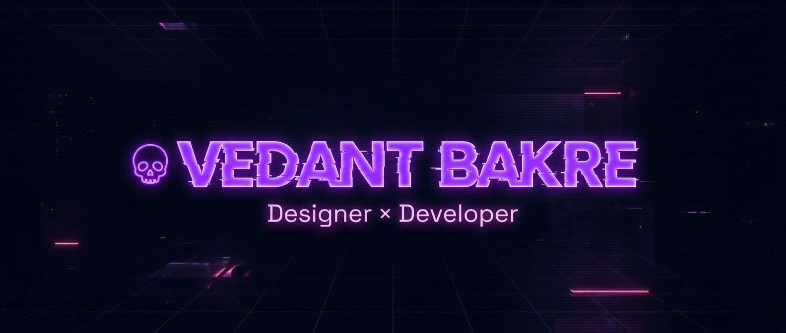
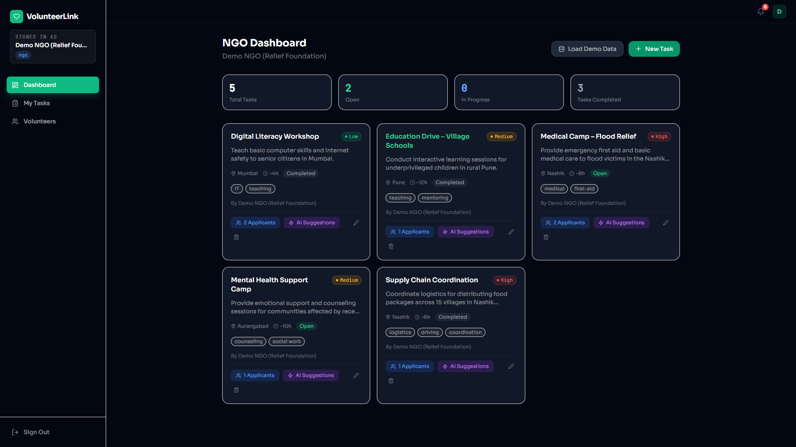
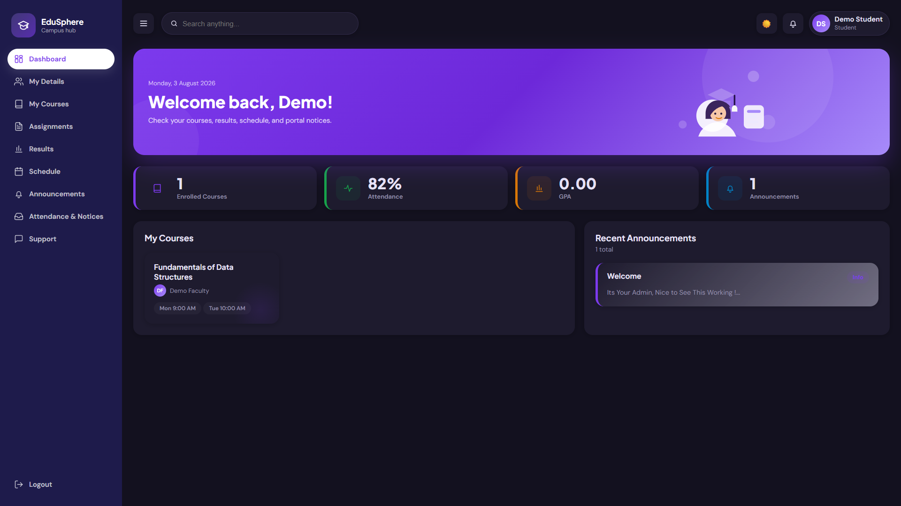
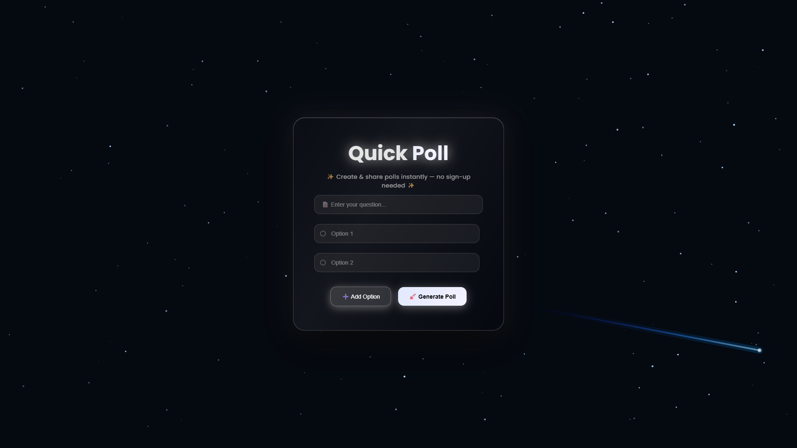
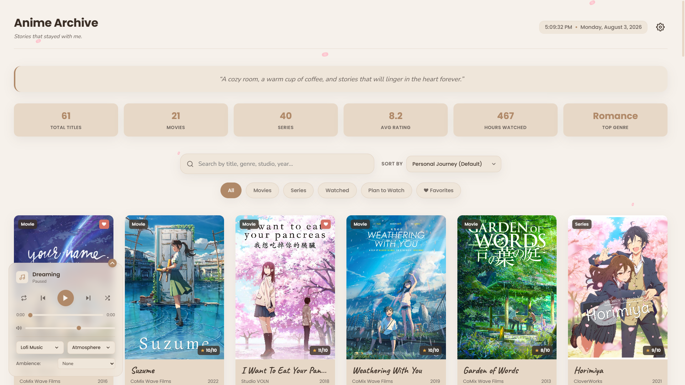
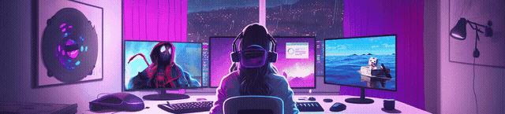

<p align="center">
  
</p>

<p align="center">
  
  
  
</p>

<p align="center">
  
</p>

<p align="center">
  
</p>

## 🧠 SYSTEM IDENTITY

```
┌──────────────────────────────────────────────────────────────────┐
│  VEDANT_OS v3.0 — IDENTITY MODULE                                │
├──────────────────────────────────────────────────────────────────┤
│                                                                  │
│  $ whoami                                                        │
│  > Vedant Bakre — Frontend Developer & Graphic Designer          │
│                                                                  │
│  $ cat mission.txt                                               │
│  > Crafting immersive, motion-driven digital experiences.        │
│  > Building interfaces that are not just functional — but alive. │
│                                                                  │
│  $ cat skills.conf                                               │
│  > 🌌 Cinematic UI       — Depth, motion, visual storytelling   │
│  > 💀 Dark UI Systems    — Elegant high-contrast dark themes    │
│  > ⚡ Performance & UX   — Fluid micro-interactions             │
│  > 🎨 Visual Design      — Photoshop, After Effects, Figma     │
│                                                                  │
│  $ cat status.log                                                │
│  > 🔭 Building: Portfolio + QuickPoll Backend                    │
│  > 🌱 Learning: Advanced React + Motion Design                   │
│  > 🎯 Goal: Craft unforgettable digital experiences              │
│                                                                  │
│  $ echo $MOTTO                                                   │
│  > "Aesthetics Matter to Me."                                    │
│                                                                  │
└──────────────────────────────────────────────────────────────────┘
```

<p align="center">
  <a href="https://drive.google.com/file/d/1Yc1od-LKNmgSPpPWsVaQVNDsLCkOGPOh/view?usp=sharing">
    
  </a>
  <a href="mailto:vedantbakre75@gmail.com">
    
  </a>
</p>

<p align="center">
  
</p>

## 🏆 ACHIEVEMENT TROPHIES

<p align="center">
  
</p>

<p align="center">
  
</p>

## 🚀 DEPLOYED SYSTEMS

<div align="center">
  <table>
    <tr>
      <td align="center" width="50%">
        <a href="https://github.com/VedantBakre/Volunteer-Link">
          
        </a>
        <br /><br />
        <h3>🤝 Volunteer Link</h3>
        <p>AI-powered volunteer coordination platform connecting NGOs with skilled volunteers.</p>
        <p>
          
          
          
          
          
        </p>
        <a href="https://github.com/VedantBakre/Volunteer-Link">
          
        </a>
        <a href="#">
          
        </a>
      </td>
      <td align="center" width="50%">
        <a href="https://github.com/VedantBakre/EduSphere">
          
        </a>
        <br /><br />
        <h3>🎓 EduSphere</h3>
        <p>Robust role-based student management system with multi-database support.</p>
        <p>
          
          
          
          
        </p>
        <a href="https://github.com/VedantBakre/EduSphere">
          
        </a>
        <a href="https://edusphere-in29.onrender.com/">
          
        </a>
      </td>
    </tr>
    <tr>
      <td align="center" width="50%">
        <a href="https://github.com/VedantBakre/Quick-Poll">
          
        </a>
        <br /><br />
        <h3>⚡ Quick Poll</h3>
        <p>Cinematic glass-styled polling app with animated starfield background.</p>
        <p>
          
          
          
          
        </p>
        <a href="https://github.com/VedantBakre/Quick-Poll">
          
        </a>
        <a href="https://vedantbakre.github.io/Quick-Poll/">
          
        </a>
      </td>
      <td align="center" width="50%">
        <a href="https://github.com/VedantBakre/AnimeArchive">
          
        </a>
        <br /><br />
        <h3>🎬 Anime Archive</h3>
        <p>Cozy personal anime gallery with lofi player, sakura engine & atmosphere mode.</p>
        <p>
          
          
          
          
          
        </p>
        <a href="https://github.com/VedantBakre/AnimeArchive">
          
        </a>
        <a href="https://vedantbakre.github.io/AnimeArchive/">
          
        </a>
      </td>
    </tr>
  </table>
</div>

<p align="center">
  
</p>

## 💻 DEVELOPMENT STACK

<details open>
<summary><b>⬢ FRONTEND</b></summary>
<br />
<p align="center">
  
</p>
</details>

<details open>
<summary><b>⬢ PROGRAMMING</b></summary>
<br />
<p align="center">
  
</p>
</details>

<details open>
<summary><b>⬢ TOOLS & DEV</b></summary>
<br />
<p align="center">
  
</p>
</details>

<details open>
<summary><b>⬢ DESIGN</b></summary>
<br />
<p align="center">
  
</p>
</details>

<p align="center">
  
</p>

## 🛠 CURRENTLY BUILDING

<div align="center">

| Status | Project | Progress |
|--------|---------|----------|
| 🔴 | **[QuickPoll Backend](https://github.com/VedantBakre/QuickPoll-Beta)** — Full-stack upgrade with real-time sync | `████████░░` 80% |
| 🟡 | **My Anime Verse** — Personal anime tracking & review platform | `██████░░░░` 60% |
| 🟢 | **Portfolio Website** — Cinematic developer portfolio experience | `████░░░░░░` 40% |

</div>

<p align="center">
  
</p>

## 🗄️ CORE LANGUAGE VAULT

<p align="center">
  <a href="https://github.com/VedantBakre/Cpp-Verse">
    
  </a>
  <a href="https://github.com/VedantBakre/Java-Hub">
    
  </a>
  <a href="https://github.com/VedantBakre/Python-Verse">
    
  </a>
</p>
<p align="center">
  <a href="https://github.com/VedantBakre/Kotlin-Playground">
    
  </a>
  <a href="https://github.com/VedantBakre/Fun-With-IOT">
    
  </a>
</p>

<p align="center">
  
</p>

## 📊 SYSTEM STATS

<p align="center">
  
</p>

<p align="center">
  
  
</p>

<p align="center">
  
</p>

<p align="center">
  
</p>

## 🐍 CONTRIBUTION SNAKE

<p align="center">
  
</p>

<p align="center">
  
</p>

## 🤝 CONNECT

<p align="center">
  <a href="https://github.com/VedantBakre" target="_blank">
    
  </a>
  <a href="https://www.linkedin.com/in/vedant-bakre-985b72388/" target="_blank">
    
  </a>
  <a href="https://www.instagram.com/vedant_bakre/" target="_blank">
    
  </a>
  <a href="https://x.com/BakreVedan69870" target="_blank">
    
  </a>
  <a href="mailto:vedantbakre75@gmail.com" target="_blank">
    
  </a>
</p>

<details>
<summary><b>🌐 More Profiles & Platforms</b></summary>
<br />
<p align="center">
  <a href="https://devfolio.co/@Vedant_Bakre" target="_blank">
    
  </a>
  <a href="https://unstop.com/u/vedanbak49009" target="_blank">
    
  </a>
  <a href="https://hack2skill.com/dashboard/user_public_profile/?userId=69d552e26a6a300c4d71a72e&utm_source=hack2skill&utm_medium=homepage" target="_blank">
    
  </a>
  <a href="https://www.chess.com/member/vedant_bakre" target="_blank">
    
  </a>
  <a href="https://www.moctale.in/u/Dead_Vedant" target="_blank">
    
  </a>
  <a href="https://drive.google.com/file/d/1Yc1od-LKNmgSPpPWsVaQVNDsLCkOGPOh/view?usp=sharing" target="_blank">
    
  </a>
</p>
</details>

<p align="center">
  
</p>

## 💀 SYSTEM TERMINAL

```bash
┌──────────────────────────────────────────────────────────────┐
│  VEDANT_OS v3.0 — SYSTEM BOOT SEQUENCE                      │
├──────────────────────────────────────────────────────────────┤
│                                                              │
│  > Loading personality.dll...              ✔ LOADED          │
│  > Mounting design_sense.sys...            ✔ ACTIVE          │
│  > Initializing dark_mode.exe...           ✔ ENABLED         │
│  > Connecting anime_inspiration.api...     ✔ LINKED          │
│  > Starting lofi_beats.mp3...              ♪ PLAYING         │
│  > Compiling creativity.cpp...             ✔ COMPILED        │
│  > Syncing github.contributions...         ✔ UP TO DATE      │
│                                                              │
│  > Status: READY TO CREATE                 ██████████ 100%   │
│                                                              │
│  FUN_FACTS.log:                                              │
│  • 🌙 Peak productivity: 11 PM - 3 AM                       │
│  • 🎬 Currently watching: anime marathons                    │
│  • 💀 Dark UI > Light UI (non-negotiable)                    │
│  • 🎧 Lofi beats = flow state activated                      │
│  • ♟️ Chess enthusiast — find me on chess.com                 │
│                                                              │
└──────────────────────────────────────────────────────────────┘
```

<p align="center">
  
</p>

## 🎵 NOW PLAYING

<p align="center">
  <a href="https://spotify-github-profile.kittinanx.com/api/view?uid=31hploc3d3k2epz3tkbjc3ewsbdu&redirect=true">
    
  </a>
</p>

<p align="center">
  
</p>

<p align="center">
  
</p>

<p align="center">
  
</p>

<p align="center">
  
</p>

<p align="center">
  
</p>
